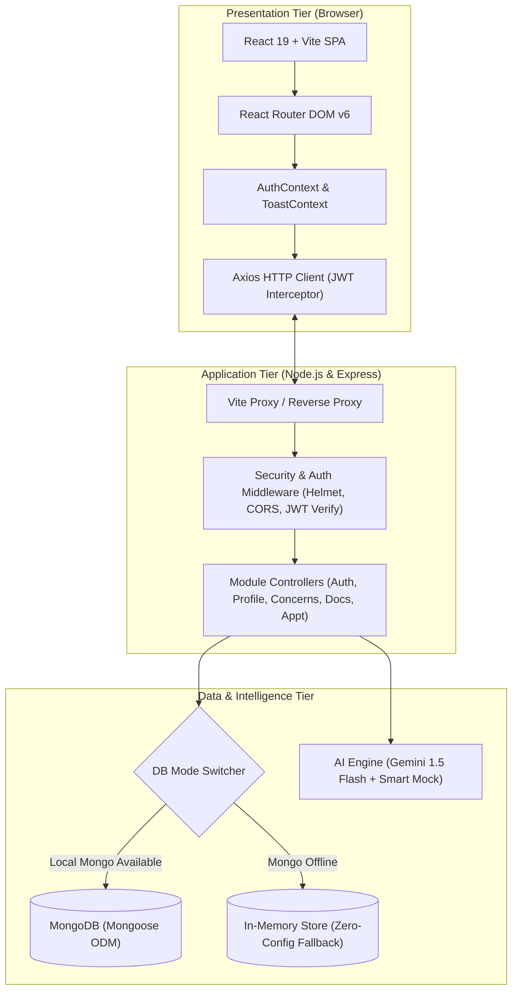
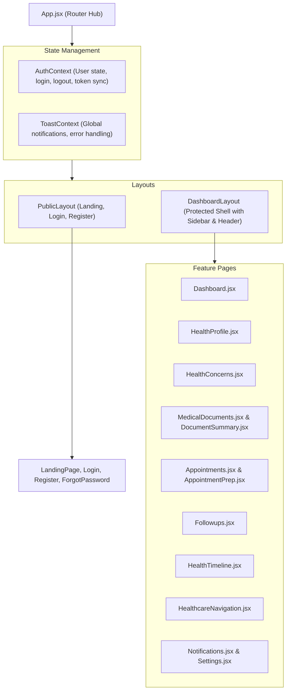
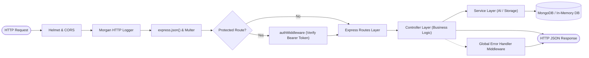
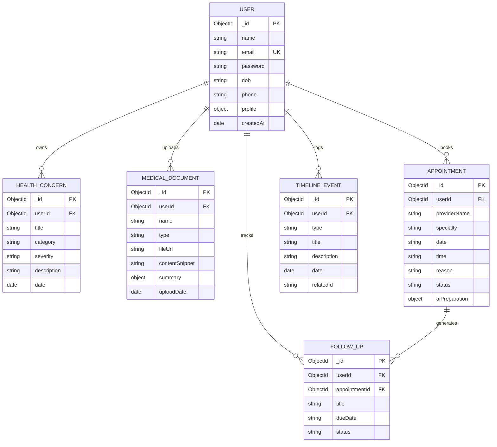
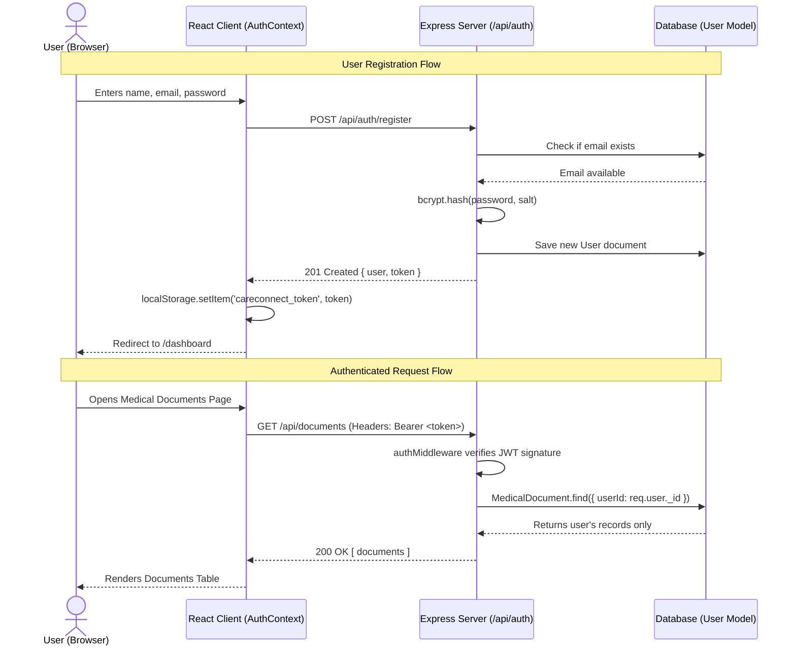
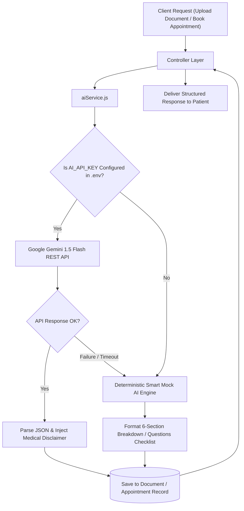
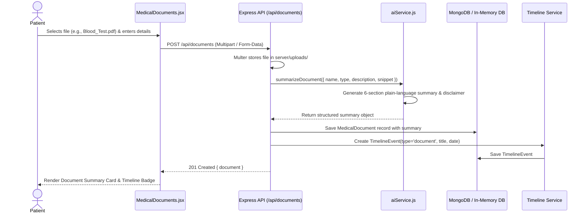

# CareConnect AI — High-Level Design (HLD)

---

## 1. System Overview

**CareConnect AI** is an AI-powered healthcare navigation and patient support platform architected as a modern, decoupled three-tier client-server application. It enables patients to centralize personal medical data, receive plain-language explanations of medical reports, prepare proactively for clinical appointments, and audit their entire health journey chronologically.

The platform follows a **Client-Server Architecture** utilizing a Single Page Application (SPA) frontend developed in **React 19**, a stateless RESTful API server powered by **Node.js and Express**, and a dual-mode persistence layer supporting **MongoDB (via Mongoose)** with an automated, zero-configuration **In-Memory Database fallback**.

---

## 2. High-Level System Architecture

The system consists of three primary tiers:

### Tier 1: Presentation Tier (Frontend)
- **Framework:** React 19 Single Page Application (SPA)
- **Build Tool & Dev Server:** Vite (with `/api` proxy targeting backend port 5000)
- **Routing:** React Router DOM v6 (declarative client-side routing, protected dashboard layout routes, and safe query redirect preserving)
- **HTTP Client:** Axios (configured with request interceptors for automatic Bearer JWT injection and response interceptors for 401 handling)

### Tier 2: Application Tier (Backend)
- **Runtime:** Node.js (v18+)
- **Web Framework:** Express.js (v4.19) implementing RESTful API architecture
- **Authentication:** Stateless JSON Web Token (JWT) verification and bcryptjs password hashing
- **Data Modeling:** Mongoose ODM schemas with field validation and pre-save hooks
- **Security & Middleware:** Helmet (secure HTTP headers), CORS (whitelisted origins), Morgan (HTTP logger), Multer (file uploads), centralized error middleware

### Tier 3: Database & External Integration Tier
- **Primary Database:** MongoDB NoSQL document store with indexing for fast multi-tenant queries
- **Fallback Database:** Built-in In-Memory Database engine (`inMemoryDb.js`) for instant zero-configuration evaluation if MongoDB is offline
- **AI Integration:** Google Gemini 1.5 Flash REST API with 8-second request timeout (`AbortController`), non-diagnostic prompt guardrails, and deterministic fallback engine

---

## 3. Frontend Architecture

The frontend is built using **React 19** with **Vite** as the build tool and development server.

### Key Frontend Architectural Patterns:
- **Centralized API Client (`client/src/services/api.js`):** Intercepts outgoing requests to automatically inject the Bearer JWT token from `localStorage`. Intercepts incoming responses to catch `401 Unauthorized` errors and cleanly redirect expired sessions to the login view.
- **Context API State Providers:** `AuthContext` exposes authentication status, logged-in user profile, and session teardown functions throughout the tree. `ToastContext` provides unified toast alerts, suppressing duplicate error banners.
- **Atomic Layout Decomposition:** Public views use `PublicLayout`, while authenticated features inherit `DashboardLayout` containing a collapsible navigation `Sidebar`, global `Header` with search and notifications badge, and medical `DisclaimerBanner`.

---

## 4. Backend Architecture

The backend is built with **Node.js** and **Express.js**, adhering to the Model-View-Controller (MVC) architectural pattern.

### Key Backend Architectural Patterns:
- **Synchronous Port Binding:** To prevent Vite proxy `ECONNREFUSED` connection drops, the server immediately binds to port 5000 synchronously before initiating asynchronous MongoDB database handshakes.
- **Graceful Persistence Fallback:** If local MongoDB is not running, the application gracefully initializes `inMemoryDb.js`, allowing full evaluation without manual database installation.
- **Tenant Isolation Barrier:** Controllers strictly query data by `userId: req.user._id`, ensuring complete multi-tenant security.

---

## 5. Database Architecture

The persistence model supports both MongoDB (via Mongoose) and an internal in-memory object store conforming to the exact same schema specifications:

---

## 6. Authentication & Security Flow

Authentication relies on stateless **JSON Web Tokens (JWT)** and **bcryptjs** password encryption:

---

## 7. AI Integration Architecture

CareConnect AI incorporates a modular AI service layer (`server/services/aiService.js`) designed for reliability, speed, and strict patient safety:

### Strict Non-Diagnostic Guardrails:
1. **System Prompt Directives:** Prompts explicitly prohibit the model from diagnosing diseases, prescribing medications, or modifying dosages.
2. **Mandatory Disclaimer Injection:** Every AI response programmatically includes the standard legal disclaimer:
   > *"AI-generated summaries are for informational purposes only and should not be considered medical advice, diagnosis, or treatment."*
3. **Smart Mock Continuity:** If no API key is provided, the mock engine generates realistic, domain-specific health analyses (analyzing CBC, Lipid panels, X-rays) so all features function seamlessly without external dependencies.

---

## 8. End-to-End Data Flow

The following sequence details how an uploaded medical document is processed, summarized by AI, stored, and integrated into the timeline:

---

## 9. Technology Stack

| Layer | Technology | Purpose |
|---|---|---|
| **Frontend Framework** | React 19 (Vite) | Single Page Application framework with high rendering efficiency |
| **Client Routing** | React Router DOM v6 | Declarative client-side route management |
| **Icons & Design** | Lucide React | Medical and navigation iconography |
| **HTTP Client** | Axios | REST API communication with automatic JWT injection |
| **Backend Runtime** | Node.js (v18+) | Server-side JavaScript runtime |
| **Web Framework** | Express.js (v4.19) | RESTful API routing, middleware chaining, and controller execution |
| **Database** | MongoDB & Mongoose | Flexible NoSQL document database with schema validation |
| **In-Memory Fallback** | Custom JavaScript Store | Zero-setup persistence for instant out-of-the-box evaluation |
| **Authentication** | JWT (`jsonwebtoken`) & `bcryptjs` | Secure stateless session management and password hashing |
| **File Handling** | Multer | Local multipart file upload middleware |
| **API Security** | Helmet & CORS | HTTP header security and controlled cross-origin access |
| **AI Integration** | Google Gemini 1.5 Flash REST | Fast LLM document parsing and question synthesis |

---

## 10. External Services and Integrations

1. **Google Gemini Generative Language API:** Invoked via standard HTTPS POST to `https://generativelanguage.googleapis.com/v1beta/models/gemini-1.5-flash:generateContent` using Bearer API keys.
2. **Local File System Storage:** Uploaded patient documents are written directly to `server/uploads/` via Multer storage engine.
3. **No External Black-Box Dependencies:** The system is fully self-contained; if Internet or external AI services are disconnected, internal fallback engines maintain complete platform availability.

