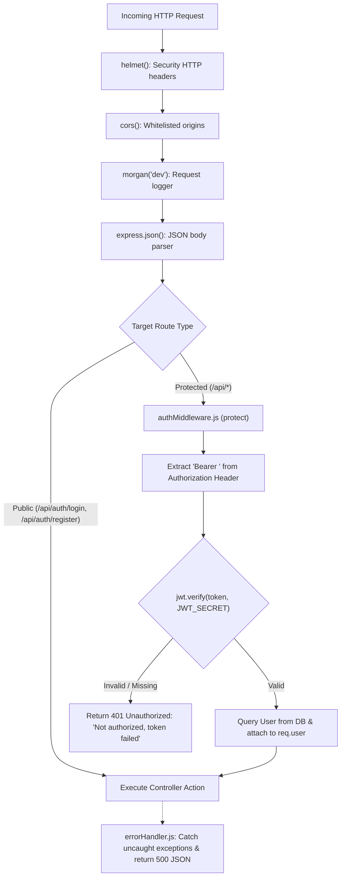

# CareConnect AI — Low-Level Design (LLD)

---

## 1. Project Directory Structure

```
c:\Users\knsja\OneDrive\Desktop\AI-Powered Healthcare Navigation & Patient Support Platform\
│
├── client/                               # Frontend Single Page Application (React 19 + Vite)
│   ├── public/
│   │   ├── favicon.svg                   # Brand favicon
│   │   └── icons.svg                     # Vector asset sprites
│   ├── src/
│   │   ├── assets/
│   │   │   └── hero.png                  # Landing page hero graphic
│   │   ├── components/                   # Reusable UI Components
│   │   │   ├── DisclaimerBanner.jsx      # Non-diagnostic medical safety warning banner
│   │   │   ├── Footer.jsx                # Public footer with links and attribution
│   │   │   ├── Header.jsx                # Top bar with search input, notifications, user menu
│   │   │   ├── Modal.jsx                 # Accessible reusable modal dialog
│   │   │   ├── Navbar.jsx                # Public navigation bar for landing/auth
│   │   │   └── Sidebar.jsx               # Authenticated collapsible sidebar navigation
│   │   ├── context/                      # React Context Providers
│   │   │   ├── AuthContext.jsx           # Global user authentication & token management
│   │   │   └── ToastContext.jsx          # Toast alert notifications with de-duplication
│   │   ├── layouts/                      # Page Shells
│   │   │   ├── DashboardLayout.jsx       # Authenticated layout with Sidebar, Header & Content
│   │   │   └── PublicLayout.jsx          # Public layout for marketing & auth routes
│   │   ├── pages/                        # View Pages
│   │   │   ├── AppointmentPrep.jsx       # AI-generated consultation prep checklist
│   │   │   ├── Appointments.jsx          # Appointment scheduling & management
│   │   │   ├── Dashboard.jsx             # Metric cards, upcoming visits, health overview
│   │   │   ├── DocumentSummary.jsx       # 6-section plain-language document breakdown
│   │   │   ├── Followups.jsx             # Post-consultation action tasks & overdue tracker
│   │   │   ├── ForgotPassword.jsx        # Password reset guidance form
│   │   │   ├── HealthcareNavigation.jsx  # Interactive AI healthcare navigation chat
│   │   │   ├── HealthConcerns.jsx        # Symptom & concern logging with severity tags
│   │   │   ├── HealthProfile.jsx         # Profile editor with live completeness meter
│   │   │   ├── HealthTimeline.jsx        # Chronological audit trail of all health events
│   │   │   ├── LandingPage.jsx           # Public marketing landing page
│   │   │   ├── Login.jsx                 # Clean user authentication interface
│   │   │   ├── MedicalDocuments.jsx      # File upload, document list, AI summarize triggers
│   │   │   ├── Notifications.jsx         # Dynamic alerts for visits, tasks, and documents
│   │   │   ├── Register.jsx              # New patient registration form
│   │   │   ├── SearchResults.jsx         # Global search result aggregator
│   │   │   └── Settings.jsx              # Password update & preferences
│   │   ├── services/
│   │   │   └── api.js                    # Axios instance with JWT & 401 interceptors
│   │   ├── App.jsx                       # Route registry and ProtectedRoute wrappers
│   │   ├── index.css                     # Custom Healthcare SaaS CSS design system
│   │   └── main.jsx                      # React 19 application root entry point
│   ├── eslint.config.js                  # Frontend linting rules
│   ├── index.html                        # HTML shell
│   ├── package.json                      # Frontend dependencies & scripts
│   └── vite.config.js                    # Vite configuration with `/api` proxy to port 5000
│
├── server/                               # Backend REST API Server (Node.js & Express)
│   ├── controllers/                      # Business Logic Route Handlers
│   │   ├── aiController.js               # Document summary, prep questions, navigation
│   │   ├── appointmentsController.js     # Appointment CRUD & AI preparation synthesis
│   │   ├── authController.js             # Register, login, getMe, changePassword
│   │   ├── concernsController.js         # Health concern CRUD & timeline auto-insertion
│   │   ├── dashboardController.js        # Aggregated stats, upcoming items, profile score
│   │   ├── documentsController.js        # Document upload, AI summary, deletion cascade
│   │   ├── followupsController.js        # Task tracking, overdue calculation, toggle
│   │   ├── notificationsController.js    # Contextual alerts generation
│   │   ├── profileController.js          # Health profile retrieval & updates
│   │   └── timelineController.js         # Unified chronological timeline aggregation
│   ├── middleware/                       # Request Processing Middleware
│   │   ├── authMiddleware.js             # Bearer JWT verification and user hydration
│   │   ├── errorHandler.js               # Centralized exception & error handler
│   │   └── uploadMiddleware.js           # Multer storage configuration for uploads
│   ├── models/                           # Mongoose Schemas & ODM Definitions
│   │   ├── Appointment.js                # Provider, date, time, reason, AI prep checklist
│   │   ├── FollowUp.js                   # Task title, due date, status, linked visit
│   │   ├── HealthConcern.js              # Symptom title, category, severity, notes
│   │   ├── MedicalDocument.js            # File metadata, snippet, 6-section AI summary
│   │   ├── TimelineEvent.js              # Reverse chronological unified event record
│   │   └── User.js                       # User credentials, bcrypt hooks, medical profile
│   ├── routes/                           # Express Router Endpoint Declarations
│   │   ├── aiRoutes.js                   # `/api/ai/*`
│   │   ├── appointmentsRoutes.js         # `/api/appointments/*`
│   │   ├── authRoutes.js                 # `/api/auth/*`
│   │   ├── concernsRoutes.js             # `/api/concerns/*`
│   │   ├── dashboardRoutes.js            # `/api/dashboard/*`
│   │   ├── documentsRoutes.js            # `/api/documents/*`
│   │   ├── followupsRoutes.js            # `/api/followups/*`
│   │   ├── notificationsRoutes.js        # `/api/notifications/*`
│   │   ├── profileRoutes.js              # `/api/profile/*`
│   │   └── timelineRoutes.js             # `/api/timeline/*`
│   ├── services/                         # Internal Platform Services
│   │   ├── aiService.js                  # Gemini 1.5 Flash REST client & smart mock engine
│   │   └── inMemoryDb.js                 # In-Memory database store for zero-config fallback
│   ├── test/                             # Automated Verification Suite
│   │   ├── run_tests.js                  # 38 comprehensive end-to-end unit and API tests
│   │   ├── test_models.js                # Schema and model integrity tests
│   │   └── test_new_user_workflow.js     # Multi-tenant data isolation verification
│   ├── uploads/                          # Local directory for uploaded files
│   │   └── .gitkeep                      # Git folder preservation marker
│   ├── utils/
│   │   └── seed.js                       # Database seeder for demo evaluation
│   ├── .env.example                      # Template environment variables
│   ├── package.json                      # Backend dependencies & scripts
│   └── server.js                         # Server entry point with synchronous port binding
│
├── .env.example                          # Root environment template
├── .gitignore                            # Comprehensive Git exclusion rules
├── HLD.md                                # High-Level Design document
├── LLD.md                                # Low-Level Design document
├── package.json                          # Monorepo runner scripts (`concurrently`)
├── PRD.md                                # Product Requirements Document
└── README.md                             # Academic project documentation
```

---

## 2. Frontend Modules & Component Responsibilities

| Component / Module | Path | Primary Responsibility |
|---|---|---|
| **App.jsx** | `client/src/App.jsx` | Defines all client routes using React Router DOM. Wraps protected routes in an auth guard that redirects unauthenticated requests to `/login`. |
| **AuthContext.jsx** | `client/src/context/AuthContext.jsx` | Holds global authentication state (`user`, `token`, `isAuthenticated`, `loading`). Persists token in `localStorage`. Provides `login()`, `register()`, and `logout()`. |
| **ToastContext.jsx** | `client/src/context/ToastContext.jsx` | Manages global toast alerts (`success`, `error`, `info`). Includes auto-dismiss timers and de-duplication to prevent repeated toast banners. |
| **api.js** | `client/src/services/api.js` | Configured Axios client with 10-second timeout. Request interceptor injects `Authorization: Bearer <token>`. Response interceptor redirects `401 Unauthorized` responses to `/login?expired=true`. |
| **DashboardLayout.jsx** | `client/src/layouts/DashboardLayout.jsx` | Master authenticated frame rendering the collapsible `Sidebar`, sticky `Header`, `DisclaimerBanner`, and main content outlet. |
| **DisclaimerBanner.jsx** | `client/src/components/DisclaimerBanner.jsx` | Sticky safety banner explicitly reminding users that CareConnect AI is an informational tool, not a medical practitioner. |
| **Dashboard.jsx** | `client/src/pages/Dashboard.jsx` | Aggregates health statistics, upcoming appointments, pending follow-ups, and profile completeness. Renders clean zero-state guidance for new users. |
| **HealthProfile.jsx** | `client/src/pages/HealthProfile.jsx` | Displays and updates blood group, allergies, existing conditions, emergency contacts, and notes. Dynamically calculates completeness percentage. |
| **HealthConcerns.jsx** | `client/src/pages/HealthConcerns.jsx` | Interface for logging symptoms with severity levels (Low, Moderate, Severe) and categories. Triggers automatic timeline synchronization. |
| **MedicalDocuments.jsx** | `client/src/pages/MedicalDocuments.jsx` | Handles file selection, upload to `/api/documents`, and triggers AI document summarization. Displays document catalog with quick summary view. |
| **DocumentSummary.jsx** | `client/src/pages/DocumentSummary.jsx` | Formats and displays the 6-section AI summary breakdown (Overview, Key Info, Important Values, Term Explanations, Doctor Questions, and Disclaimer). |
| **Appointments.jsx** | `client/src/pages/Appointments.jsx` | Schedules and manages appointments. Enforces mandatory consultation reasons and provides direct links to the AI preparation screen. |
| **AppointmentPrep.jsx** | `client/src/pages/AppointmentPrep.jsx` | Displays customized AI consultation preparation checklists (questions to ask, topics to discuss, documents to carry). |
| **Followups.jsx** | `client/src/pages/Followups.jsx` | Lists post-visit tasks. Computes live status badges (`Pending`, `Completed`, `Overdue`) based on due dates. Allows single-click status toggling. |
| **HealthTimeline.jsx** | `client/src/pages/HealthTimeline.jsx` | Renders a unified, chronological activity feed of concerns, documents, appointments, and follow-ups with category filtering and keyword search. |
| **HealthcareNavigation.jsx** | `client/src/pages/HealthcareNavigation.jsx` | Conversational interface providing non-diagnostic healthcare navigation advice and workflow guidance. |
| **Notifications.jsx** | `client/src/pages/Notifications.jsx` | Contextual alert center notifying patients of upcoming appointments within 48 hours and overdue follow-up tasks. |
| **Settings.jsx** | `client/src/pages/Settings.jsx` | User preferences and password change form (verifies existing password before applying new credentials). |

---

## 3. Database Schemas & Data Models

### 3.1 User Model (`server/models/User.js`)
```javascript
{
  name: { type: String, required: true },
  email: { type: String, required: true, unique: true, lowercase: true },
  password: { type: String, required: true },
  dob: { type: String, default: '' },
  phone: { type: String, default: '' },
  profile: {
    bloodGroup: { type: String, default: 'Not specified' },
    allergies: { type: [String], default: [] },
    existingConditions: { type: [String], default: [] },
    emergencyContact: {
      name: { type: String, default: '' },
      phone: { type: String, default: '' },
      relation: { type: String, default: '' }
    },
    relevantNotes: { type: String, default: '' }
  },
  createdAt: { type: Date, default: Date.now }
}
```
- **Hooks:** `pre('save')` hashes `password` with bcrypt (salt rounds = 10) if modified.
- **Methods:** `matchPassword(enteredPassword)` compares plaintext against hashed password.

### 3.2 HealthConcern Model (`server/models/HealthConcern.js`)
```javascript
{
  userId: { type: mongoose.Schema.Types.ObjectId, ref: 'User', required: true, index: true },
  title: { type: String, required: true },
  description: { type: String, default: '' },
  category: { type: String, default: 'General' }, // General, Pain, Digestion, Respiratory, Cardiovascular, Skin, Other
  severity: { type: String, default: 'Moderate' }, // Low, Moderate, Severe
  date: { type: Date, default: Date.now },
  notes: { type: String, default: '' },
  createdAt: { type: Date, default: Date.now }
}
```

### 3.3 MedicalDocument Model (`server/models/MedicalDocument.js`)
```javascript
{
  userId: { type: mongoose.Schema.Types.ObjectId, ref: 'User', required: true, index: true },
  name: { type: String, required: true },
  type: { 
    type: String, 
    enum: ['Blood Test', 'Scan', 'Prescription', 'Consultation Report', 'Discharge Summary', 'Other'],
    default: 'Blood Test'
  },
  fileUrl: { type: String, default: '' },
  uploadDate: { type: Date, default: Date.now },
  description: { type: String, default: '' },
  contentSnippet: { type: String, default: '' },
  summary: {
    overview: { type: String, default: '' },
    keyInfo: [{ type: String }],
    importantValues: [{ type: String }],
    termsExplained: [{ term: String, explanation: String }],
    questionsToDiscuss: [{ type: String }],
    disclaimer: { type: String, default: 'AI-generated summaries are for informational purposes only...' }
  },
  createdAt: { type: Date, default: Date.now }
}
```

### 3.4 Appointment Model (`server/models/Appointment.js`)
```javascript
{
  userId: { type: mongoose.Schema.Types.ObjectId, ref: 'User', required: true, index: true },
  providerName: { type: String, required: true },
  specialty: { type: String, default: 'General Physician' },
  date: { type: String, required: true }, // Format: YYYY-MM-DD
  time: { type: String, required: true }, // Format: HH:MM AM/PM
  location: { type: String, default: 'Main Clinic' },
  reason: { type: String, default: '' },  // Validated mandatory upon booking
  notes: { type: String, default: '' },
  status: { type: String, enum: ['Upcoming', 'Completed', 'Cancelled'], default: 'Upcoming' },
  aiPreparation: {
    questionsToAsk: [{ type: String }],
    infoToBring: [{ type: String }],
    topicsToDiscuss: [{ type: String }],
    relevantDocuments: [{ type: String }]
  },
  createdAt: { type: Date, default: Date.now }
}
```

### 3.5 FollowUp Model (`server/models/FollowUp.js`)
```javascript
{
  userId: { type: mongoose.Schema.Types.ObjectId, ref: 'User', required: true, index: true },
  appointmentId: { type: mongoose.Schema.Types.ObjectId, ref: 'Appointment' },
  title: { type: String, required: true },
  description: { type: String, default: '' },
  dueDate: { type: String, required: true }, // Format: YYYY-MM-DD
  status: { type: String, enum: ['Pending', 'Completed', 'Overdue'], default: 'Pending' },
  createdAt: { type: Date, default: Date.now }
}
```

### 3.6 TimelineEvent Model (`server/models/TimelineEvent.js`)
```javascript
{
  userId: { type: mongoose.Schema.Types.ObjectId, ref: 'User', required: true, index: true },
  type: { type: String, enum: ['concern', 'document', 'appointment', 'followup', 'note'], required: true },
  title: { type: String, required: true },
  description: { type: String, default: '' },
  date: { type: Date, default: Date.now },
  relatedId: { type: String, default: '' },
  createdAt: { type: Date, default: Date.now }
}
```

---

## 4. Backend Routes, Controllers & API Endpoints

### 4.1 Authentication Module (`/api/auth`)
| Method | Endpoint | Protection | Controller Function | Description |
|---|---|---|---|---|
| `POST` | `/api/auth/register` | Public | `registerUser` | Validates email uniqueness and password length (min 6); hashes password; creates user; returns JWT. |
| `POST` | `/api/auth/login` | Public | `loginUser` | Authenticates email & password via bcrypt comparison; returns user object & JWT. |
| `GET` | `/api/auth/me` | Protected | `getMe` | Returns authenticated user profile without password. |
| `PUT` | `/api/auth/change-password` | Protected | `changePassword` | Validates old password and updates to new hashed password. |

### 4.2 Health Profile Module (`/api/profile`)
| Method | Endpoint | Protection | Controller Function | Description |
|---|---|---|---|---|
| `GET` | `/api/profile` | Protected | `getProfile` | Retrieves user profile, emergency contact, allergies, conditions, and completeness score. |
| `PUT` | `/api/profile` | Protected | `updateProfile` | Updates personal demographics, blood group, allergies, conditions, and notes. |

### 4.3 Health Concerns Module (`/api/concerns`)
| Method | Endpoint | Protection | Controller Function | Description |
|---|---|---|---|---|
| `GET` | `/api/concerns` | Protected | `getConcerns` | Returns user's health concerns sorted by date descending. |
| `POST` | `/api/concerns` | Protected | `createConcern` | Creates a new concern and automatically appends a corresponding TimelineEvent. |
| `PUT` | `/api/concerns/:id` | Protected | `updateConcern` | Edits concern details and updates linked timeline event. |
| `DELETE` | `/api/concerns/:id` | Protected | `deleteConcern` | Deletes concern and removes corresponding timeline event. |

### 4.4 Medical Documents Module (`/api/documents`)
| Method | Endpoint | Protection | Controller Function | Description |
|---|---|---|---|---|
| `GET` | `/api/documents` | Protected | `getDocuments` | Lists all documents uploaded by the authenticated user. |
| `POST` | `/api/documents` | Protected | `uploadDocument` | Accepts multipart file or metadata; triggers AI summarization; saves record and timeline event. |
| `GET` | `/api/documents/:id` | Protected | `getDocumentById` | Retrieves a specific document and its full 6-section AI summary. |
| `DELETE` | `/api/documents/:id` | Protected | `deleteDocument` | Removes document and cleans up associated timeline event. |

### 4.5 Appointments Module (`/api/appointments`)
| Method | Endpoint | Protection | Controller Function | Description |
|---|---|---|---|---|
| `GET` | `/api/appointments` | Protected | `getAppointments` | Fetches user's appointments sorted by date. |
| `POST` | `/api/appointments` | Protected | `createAppointment` | Validates mandatory `reason`; queries active concerns; triggers AI prep synthesis; creates record and timeline event. |
| `GET` | `/api/appointments/:id` | Protected | `getAppointmentById` | Fetches single appointment with full AI prep breakdown. |
| `PUT` | `/api/appointments/:id` | Protected | `updateAppointment` | Updates appointment details or toggles status (`Upcoming`, `Completed`, `Cancelled`). |
| `DELETE` | `/api/appointments/:id` | Protected | `deleteAppointment` | Cancels and deletes appointment record. |

### 4.6 Follow-ups Module (`/api/followups`)
| Method | Endpoint | Protection | Controller Function | Description |
|---|---|---|---|---|
| `GET` | `/api/followups` | Protected | `getFollowups` | Fetches tasks and dynamically evaluates `Overdue` status against current date. |
| `POST` | `/api/followups` | Protected | `createFollowup` | Creates new follow-up task and timeline event. |
| `PUT` | `/api/followups/:id` | Protected | `updateFollowup` | Toggles status (`Completed` / `Pending`) or edits task parameters. |
| `DELETE` | `/api/followups/:id` | Protected | `deleteFollowup` | Removes task and associated timeline event. |

### 4.7 Timeline & Dashboard Modules
| Method | Endpoint | Protection | Controller Function | Description |
|---|---|---|---|---|
| `GET` | `/api/timeline` | Protected | `getTimelineEvents` | Returns unified activity stream in reverse chronological order. |
| `GET` | `/api/dashboard` | Protected | `getDashboardSummary` | Returns consolidated statistics: profile score, concern count, upcoming visits, documents count, and pending follow-ups. |
| `GET` | `/api/notifications` | Protected | `getNotifications` | Generates active alerts: appointments within 48h and overdue follow-up tasks. |

### 4.8 AI Service Module (`/api/ai`)
| Method | Endpoint | Protection | Controller Function | Description |
|---|---|---|---|---|
| `POST` | `/api/ai/summarize-document` | Protected | `summarizeDoc` | Generates plain-language document breakdown via Gemini or smart mock. |
| `POST` | `/api/ai/appointment-questions` | Protected | `generateQuestions` | Generates prioritized consultation questions and document lists based on visit reason. |
| `POST` | `/api/ai/organize-information` | Protected | `organizeInfo` | Returns structured health navigation guidance with safety disclaimer. |

---

## 5. Middleware Pipeline



---

## 6. Request & Response Formats (Examples)

### 6.1 User Registration
- **Request (`POST /api/auth/register`):**
  ```json
  {
    "name": "Jane Doe",
    "email": "jane@example.com",
    "password": "securepassword123",
    "dob": "1995-05-12",
    "phone": "+91 98765 43210"
  }
  ```
- **Response (`201 Created`):**
  ```json
  {
    "_id": "673752e2a8934b1234567890",
    "name": "Jane Doe",
    "email": "jane@example.com",
    "dob": "1995-05-12",
    "phone": "+91 98765 43210",
    "profile": {
      "bloodGroup": "Not specified",
      "allergies": [],
      "existingConditions": [],
      "emergencyContact": { "name": "", "phone": "", "relation": "" },
      "relevantNotes": ""
    },
    "token": "eyJhbGciOiJIUzI1NiIsInR5cCI6IkpXVCJ9..."
  }
  ```

### 6.2 Appointment Creation with Mandatory Reason & AI Prep
- **Request (`POST /api/appointments`):**
  ```json
  {
    "providerName": "Dr. Sarah Jenkins",
    "specialty": "Cardiology",
    "date": "2026-11-20",
    "time": "10:30 AM",
    "location": "Heart Health Clinic, Room 402",
    "reason": "Occasional chest tightness and palpitations during morning workouts"
  }
  ```
- **Response (`201 Created`):**
  ```json
  {
    "_id": "673753faa8934b1234567891",
    "userId": "673752e2a8934b1234567890",
    "providerName": "Dr. Sarah Jenkins",
    "specialty": "Cardiology",
    "date": "2026-11-20",
    "time": "10:30 AM",
    "location": "Heart Health Clinic, Room 402",
    "reason": "Occasional chest tightness and palpitations during morning workouts",
    "status": "Upcoming",
    "aiPreparation": {
      "questionsToAsk": [
        "Are these workout-induced palpitations indicative of arrhythmia?",
        "Should I undergo an exercise stress echocardiogram or Holter monitoring?",
        "Are there specific target heart-rate zones I should observe while exercising?"
      ],
      "infoToBring": [
        "Recent blood pressure and heart rate logs",
        "List of all current daily supplements and medications"
      ],
      "topicsToDiscuss": [
        "Onset, duration, and exercise intensity when tightness occurs",
        "Family cardiovascular history"
      ],
      "relevantDocuments": ["Recent ECG or Lipid Panel records"]
    }
  }
  ```

### 6.3 Medical Document Summary Format
- **Document AI Output Object (`MedicalDocument.summary`):**
  ```json
  {
    "overview": "Comprehensive metabolic panel showing normal electrolyte balances and stable renal function markers.",
    "keyInfo": [
      "Fasting blood glucose is well within normal clinical limits.",
      "Kidney markers (Creatinine and BUN) demonstrate healthy filtration rates.",
      "Liver enzyme levels (ALT/AST) show mild elevation warranting hydration review."
    ],
    "importantValues": [
      "Glucose: 88 mg/dL (Normal Range: 70-99 mg/dL)",
      "Creatinine: 0.9 mg/dL (Normal Range: 0.6-1.2 mg/dL)",
      "eGFR: > 90 mL/min/1.73m2 (Optimal)"
    ],
    "termsExplained": [
      {
        "term": "eGFR",
        "explanation": "Estimated Glomerular Filtration Rate: A metric reflecting how efficiently kidneys filter waste from blood."
      },
      {
        "term": "ALT",
        "explanation": "Alanine Aminotransferase: An enzyme found primarily in liver cells."
      }
    ],
    "questionsToDiscuss": [
      "Do the mild liver enzyme shifts suggest dietary or medication adjustments?",
      "When is the recommended interval for follow-up testing?"
    ],
    "disclaimer": "AI-generated summaries are for informational purposes only and should not be considered medical advice, diagnosis, or treatment."
  }
  ```

---

## 7. Error Handling & Validation Logic

1. **Client-Side Validation:**
   - Registration enforces email format, minimum 6-character password, and password confirmation matching.
   - Appointment booking enforces non-empty, non-whitespace consultation reasons with explicit visual cues (`*` and toast alerts).
2. **Server-Side Validation:**
   - Controllers reject missing fields with `400 Bad Request` before issuing database calls.
   - Duplicate user registrations return `400 Bad Request: 'User already exists'`.
   - Access to another user's document or appointment returns `404 Not Found` or `401 Unauthorized` ensuring complete multi-tenant isolation.
3. **Global Exception Catching:**
   - `errorHandler.js` intercepts all unhandled errors thrown in route controllers, logging the stack trace in development and returning `{ success: false, message: err.message }` to prevent server crashes.

---

## 8. Automated Test Suite Architecture

CareConnect AI includes a complete automated test runner (`server/test/run_tests.js`) that verifies 38 critical operations:
- **Authentication (11 Tests):** Seeded demo login, generic login, 401 invalid login, user registration, duplicate email rejection, password length rejection, security bypass prevention, `/auth/me` verification, 401 rejection on unauthenticated routes, password update.
- **Profile (1 Test):** Profile update and completeness calculation.
- **Health Concerns (3 Tests):** Creation, editing, timeline linkage.
- **Documents & AI (2 Tests):** Document upload, 6-section summary generation, single document retrieval.
- **Appointments & AI Prep (4 Tests):** Mandatory reason validation (400 rejection), appointment creation with AI prep, editing, single appointment retrieval.
- **Follow-ups (2 Tests):** Due date calculation, overdue status detection, status toggling.
- **Healthcare Navigation (2 Tests):** Non-diagnostic safety disclaimer enforcement, actionable guidance formatting.
- **Dynamic Notifications (1 Test):** Real-time generation of visit alerts and task reminders.
- **Multi-Tenant Isolation (4 Tests):** Verification that User B cannot access, edit, or delete User A's documents, concerns, appointments, or follow-ups.
- **Deletion Cascade (4 Tests):** Removal of concerns, documents, appointments, and follow-ups with timeline synchronization.
- **New User Workflow (4 Tests):** Verification of clean zero-state dashboard, independent profile creation, dynamic statistic updating, and data persistence across sessions.

