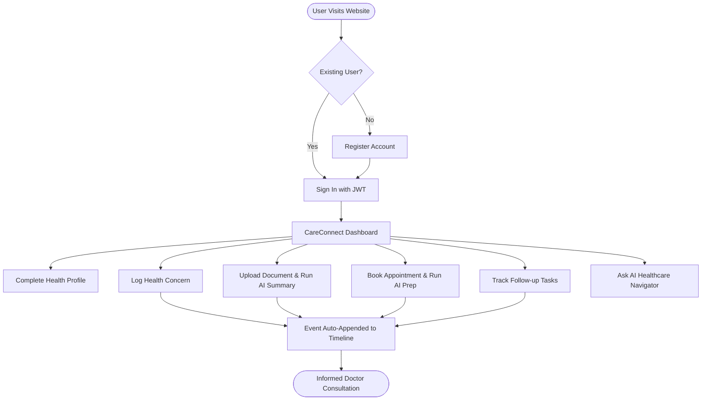

# CareConnect AI — Product Requirements Document (PRD)

---

## 1. Project Title & Overview

- **Project Title:** CareConnect AI (AI-Powered Healthcare Navigation & Patient Support Platform)
- **Academic Context:** Individual B.Tech Computer Science & Engineering (CSE) Capstone Project, SRM University AP
- **Author:** Jayram Kumar
- **Platform Type:** Patient-facing Web Application (Full-Stack Responsive SaaS)
- **Core Philosophy:** **ORGANIZE → UNDERSTAND → PREPARE → TRACK**

CareConnect AI is a centralized patient support platform designed to bridge the gap between complex clinical workflows and everyday patient understanding. The platform provides individuals and caregivers with tools to securely organize health profiles, log ongoing health concerns, upload and receive plain-language summaries of medical documents, generate structured preparation checklists for doctor appointments, and maintain an interactive chronological health timeline.

---

## 2. Problem Statement

### 2.1 The Problem
In modern healthcare, patient information is heavily fragmented across physical documents, diverse hospital portals, diagnostic lab PDFs, and handwritten prescriptions. This fragmentation leads to:
1. **Medical Jargon Barriers:** Patients struggle to interpret reference ranges, abbreviations (e.g., ALT, AST, TSH), and clinical terminology found in lab panels and radiology scans.
2. **Rushed Consultations:** Consultations typically last only 10–15 minutes. Unprepared patients frequently forget their symptom timelines, critical questions, or relevant past documents.
3. **Lost Follow-up Care:** Diagnostic recommendations, medication reviews, and lifestyle check-ins frequently slip through the cracks after a patient leaves the clinic.
4. **Data Isolation & Anxiety:** Lack of a single chronological record creates anxiety and forces patients to repeatedly recount their entire medical history to every new specialist.

### 2.2 The Solution
CareConnect AI addresses these challenges through a unified, patient-first web application:
- **Centralize:** Securely store personal medical profiles, emergency contacts, blood groups, and allergies.
- **De-jargonize:** Provide automated, 6-section plain-language summaries of uploaded documents with explicit non-diagnostic safety guardrails.
- **Consultation Prep:** Synthesize doctor specialty, visit reason, and active concerns into prioritized questions and required document checklists.
- **Chronological Auditing:** Automatically record every health concern, document upload, and consultation into a consolidated chronological timeline.

---

## 3. Target Users

1. **Patients Managing Ongoing Conditions:** Individuals with hypertension, diabetes, asthma, or chronic symptoms who need continuous tracking.
2. **Family Caregivers:** Individuals managing health records, appointments, and medication tasks for aging parents or children.
3. **General Patients Preparing for Consultations:** Patients seeking to maximize doctor consultation time through structured preparation.
4. **Health-Conscious Individuals:** Users maintaining proactive digital backups of diagnostic documents and medical milestones.

---

## 4. Project Objectives

- **O1:** Provide 100% data isolation across multiple registered users using JWT-authenticated sessions and tenant-bound database queries.
- **O2:** Deliver plain-language document breakdowns within 3 seconds using modular AI summarization with deterministic smart mock fallbacks.
- **O3:** Improve consultation readiness by automatically generating contextual questions and document checklists based on active concerns.
- **O4:** Prevent post-consultation drop-off by tracking follow-ups with color-coded status badges and automated overdue detection.
- **O5:** Enforce patient safety through strict non-diagnostic disclaimers and refusal of clinical diagnoses or medication prescriptions.

---

## 5. Functional Requirements (FR)

### FR-1: User Authentication & Account Management
- **FR-1.1:** System shall permit new users to register with full name, unique email, password (min 6 characters), optional date of birth, and phone number.
- **FR-1.2:** Passwords must be hashed using `bcryptjs` with salt rounds before database persistence.
- **FR-1.3:** System shall authenticate users via email and password, issuing a signed JSON Web Token (JWT) valid for 30 days.
- **FR-1.4:** System shall support password updates from the Settings page by validating the current password prior to saving the new password.
- **FR-1.5:** Generic placeholders (`you@example.com`, `+91 XXXXX XXXXX`) must be presented on all input forms; no personal data shall be pre-filled.

### FR-2: Personal Health Profile
- **FR-2.1:** System shall maintain an independent health profile for each registered user containing: blood group, allergies (comma-separated list), existing conditions, emergency contact (name, phone, relation), and relevant notes.
- **FR-2.2:** Profile updates shall calculate and display a live Profile Completeness percentage.
- **FR-2.3:** Emergency contact information must be easily accessible from both the Profile view and the Dashboard.

### FR-3: Health Concerns Tracking
- **FR-3.1:** Users shall be able to log health concerns with title, description, category (General, Pain, Digestion, Respiratory, Cardiovascular, Skin, Other), severity (Low, Moderate, Severe), and date.
- **FR-3.2:** Creating a concern shall automatically insert a corresponding event into the patient's Health Timeline.
- **FR-3.3:** Users shall be able to filter concerns by category and severity, edit existing concerns, or delete them (cascading to remove the associated timeline event).

### FR-4: Medical Documents & AI Summarization
- **FR-4.1:** Users shall upload document metadata and files (PDF, PNG, JPG) categorized as Blood Test, Scan, Prescription, Consultation Report, Discharge Summary, or Other.
- **FR-4.2:** Upon upload, the AI service shall parse document metadata and content snippets to generate a 6-part summary:
  1. *Overview* (plain-language summary)
  2. *Key Information* (bulleted highlights)
  3. *Important Values* (test metrics with context)
  4. *Medical Terms Explained* (jargon-to-plain-English definitions)
  5. *Questions to Discuss with Doctor*
  6. *Mandatory Safety Disclaimer*
- **FR-4.3:** Users can view the formatted summary, download/inspect the uploaded file, and delete the record.

### FR-5: Appointments & AI Consultation Preparation
- **FR-5.1:** Users shall book appointments with healthcare provider name, specialty, date (`YYYY-MM-DD`), time, location, reason for consultation (mandatory field), and optional notes.
- **FR-5.2:** Submitting an appointment shall automatically trigger the AI preparation engine, incorporating the user's active health concerns to create:
  - *Questions to Ask the Doctor*
  - *Relevant Documents to Bring*
  - *Topics to Discuss*
- **FR-5.3:** Users shall view, edit, mark as Completed, or cancel/delete appointments.

### FR-6: Follow-up Action Tracker
- **FR-6.1:** Users shall log post-consultation tasks (e.g., repeat lab tests, prescription refills) with title, description, due date, and linked appointment.
- **FR-6.2:** The system shall automatically compute status (`Pending`, `Completed`, or `Overdue` based on the current calendar date).
- **FR-6.3:** Users can toggle follow-up task completion directly with one click.

### FR-7: Chronological Health Timeline
- **FR-7.1:** System shall aggregate all patient milestones (`concern`, `document`, `appointment`, `followup`, `note`) in reverse chronological order.
- **FR-7.2:** Users shall filter timeline items by event type and search events by keyword.

### FR-8: AI Healthcare Navigation Assistant
- **FR-8.1:** Users shall access an interactive AI navigation chat interface to ask questions about navigating tests, preparing for doctor visits, or understanding medical workflows.
- **FR-8.2:** The assistant must inject a prominent non-diagnostic disclaimer and provide structured guidance without offering medical prescriptions or diagnostic claims.

### FR-9: Central Dashboard & Dynamic Analytics
- **FR-9.1:** The dashboard shall present live summary cards: Profile Completeness %, Active Health Concerns, Upcoming Appointments, Stored Documents, and Pending Follow-ups.
- **FR-9.2:** Dashboard cards must render clean zero/empty states for newly registered users with quick-action links.

### FR-10: Notifications & Global Search
- **FR-10.1:** The system shall dynamically generate notifications for upcoming appointments (within 48 hours), overdue follow-ups, and recently summarized documents.
- **FR-10.2:** Global search shall enable instant querying across concerns, appointments, documents, and follow-ups.

---

## 6. Non-Functional Requirements (NFR)

- **NFR-1 (Security):** All passwords hashed via bcrypt. All protected REST APIs require a valid Bearer JWT. HTTP response headers protected with Helmet.
- **NFR-2 (Multi-Tenant Isolation):** Every database query strictly filters by `userId: req.user._id` to eliminate cross-tenant data leakage.
- **NFR-3 (Performance & Responsiveness):** Dashboard summary queries and timeline aggregations execute in under 200 ms. AI summaries complete within 3 seconds.
- **NFR-4 (High Availability & Zero-Crash Startup):** Express backend binds synchronously to port 5000 before initiating database connections. If MongoDB is unavailable, the system automatically falls back to In-Memory Database Mode for uninterrupted evaluation.
- **NFR-5 (Usability & Design):** Fully responsive layout (mobile, tablet, desktop) using custom CSS SaaS design system, glassmorphism accents, and accessible contrast ratios.
- **NFR-6 (Medical Disclaimer & Ethics):** Every AI output explicitly displays: *"AI-generated summaries are for informational purposes only and should not be considered medical advice, diagnosis, or treatment."*

---

## 7. User Stories

| ID | As a... | I want to... | So that... |
|---|---|---|---|
| **US-1** | New Patient | Register with my personal details and create a profile | I have an independent health dashboard that no other user can see. |
| **US-2** | Patient with Symptoms | Log my recurring migraines with severity and category | My symptoms are chronologically documented for my next visit. |
| **US-3** | Confused Patient | Upload my blood test report and view an AI summary | I can understand medical terms in plain English without confusion. |
| **US-4** | Busy Patient | Book an appointment and get an AI preparation list | I know exactly what questions to ask my doctor and what documents to carry. |
| **US-5** | Patient on Medication | Track follow-up lab tests with due dates | I am alerted when tests are upcoming or overdue. |
| **US-6** | Caregiver | View the chronological health timeline | I can see the complete clinical history of my family member at a glance. |

---

## 8. User Workflows

---

## 9. Scope of the Project

### In-Scope (Implemented & Verified)
- Complete user registration, login, JWT authentication, and password update.
- Personal health profile management with profile completeness indicator.
- Health concerns logging with severity, categories, and timeline linkage.
- Document upload with automated 6-part AI summarization (Gemini API + smart mock fallback).
- Appointment scheduling with mandatory reason validation and automated AI consultation preparation.
- Follow-up action tracker with live overdue calculation and completion toggling.
- Chronological health timeline aggregating all patient events.
- AI Healthcare Navigation Assistant chat with safety disclaimers.
- Global search across all user records.
- In-memory database fallback mode alongside local MongoDB integration.

### Out-of-Scope (Future Enhancements)
- Direct EHR/HL7 FHIR hospital database synchronization.
- Real-time video/telehealth consultation rooms.
- Continuous biometric sync from wearable devices (Apple Watch, Fitbit).
- Automated SMS/WhatsApp notifications via Twilio.
- Multi-lingual audio/speech-to-text document ingestion.

---

## 10. Expected Outcomes

1. **Enhanced Health Literacy:** Patients understand their medical records, reducing anxiety and misinformation.
2. **Productive Consultations:** Structured question checklists minimize forgotten topics during brief clinical appointments.
3. **Zero Lost Follow-ups:** Proactive tracking prevents delayed diagnostic tests and untreated symptoms.
4. **Reliable Academic Evaluation:** Robust hybrid database architecture guarantees seamless evaluation on any machine without complex database setup.

